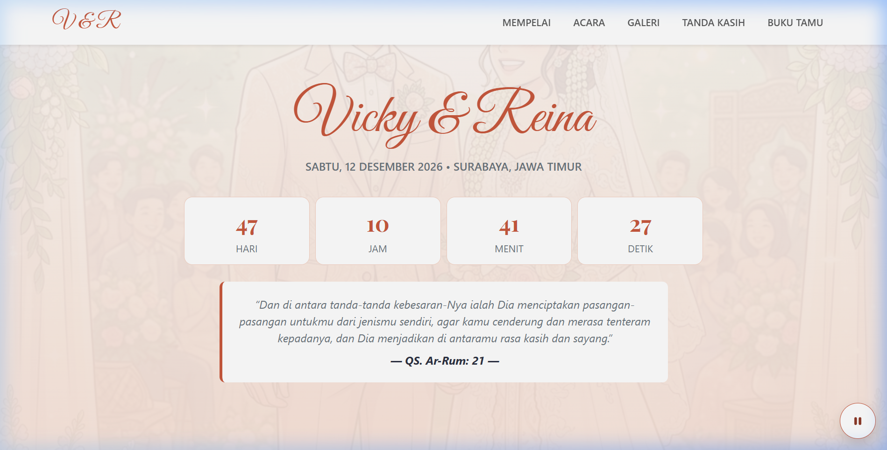
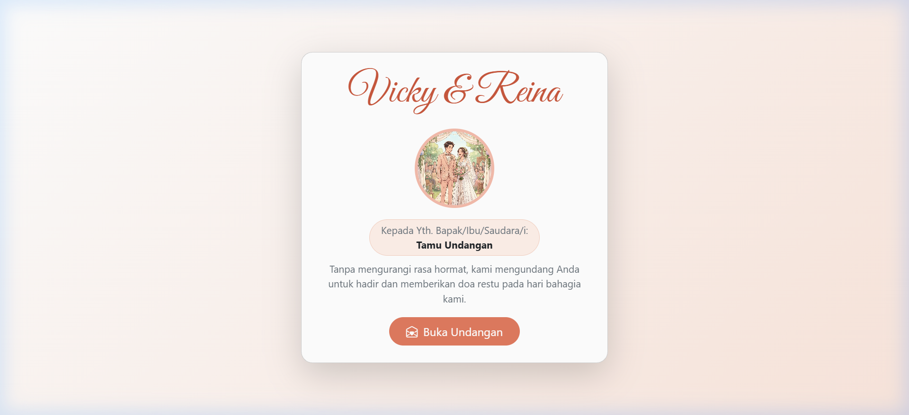
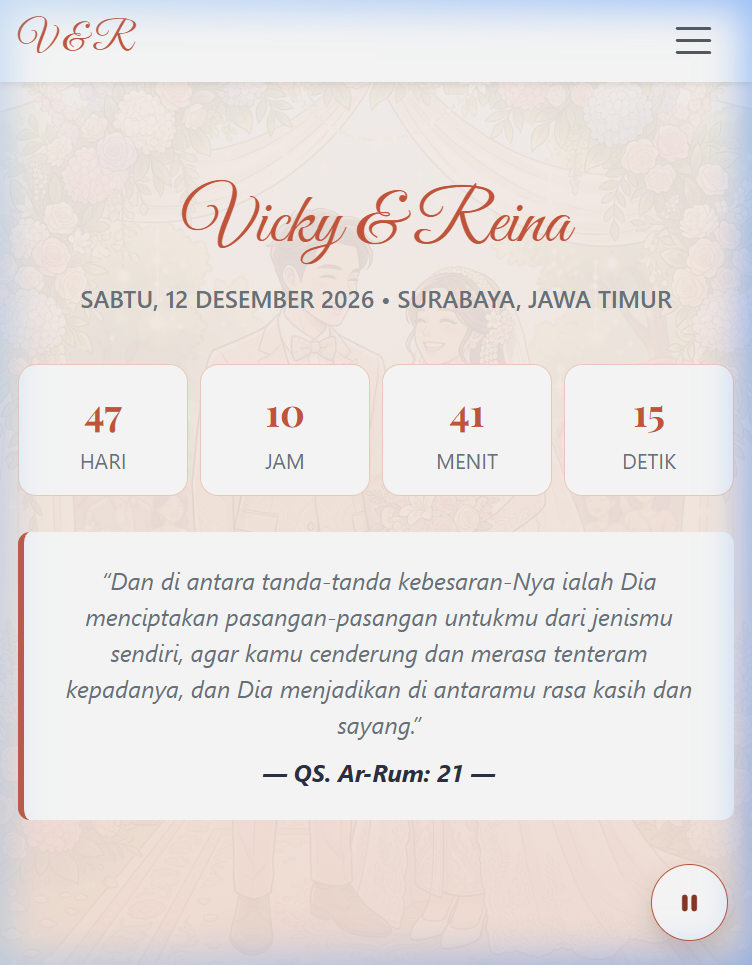

# Digital Wedding Invitation


<p align="center">
  <a href="https://www.unesa.ac.id/" title="Universitas Negeri Surabaya">
    
  </a>
</p>

<p align="center">
  <strong>Pemrograman Berbasis Platform — Project Mandiri</strong><br />
  <a href="https://www.unesa.ac.id/">Universitas Negeri Surabaya (UNESA)</a>
</p>

---

Website undangan pernikahan digital yang elegan, modern, dan interaktif. Dibangun menggunakan **HTML5**, **Vanilla CSS3**, **Bootstrap 5.3**, dan **Vanilla JavaScript** dengan sentuhan palet tema *Peach Blossom* & *Warm Terracotta*. Dilengkapi dengan animasi pembuka cover layar penuh, musik latar interaktif, hitung mundur (*countdown*) waktu nyata, integrasi rute Google Maps, galeri momen kebersamaan, amplop digital QRIS, serta buku tamu interaktif.

---

## Pratinjau

### Tampilan Desktop
<p align="center">
  
</p>

### Tampilan Cover & Mobile Responsif
<p align="center">
  
  &nbsp;&nbsp;&nbsp;&nbsp;
  
</p>

---

## Fitur Utama

- **Cover Undangan Interaktif**: Tampilan layar penuh dengan sambutan nama tamu dan tombol *"Buka Undangan"* yang membuka kunci scroll halaman serta memutar musik secara otomatis.
- **Kontrol Musik Latar**: Tombol mengambang (*floating toggle button*) di sudut kanan bawah untuk memutar atau menjeda lagu menggunakan HTML5 Audio API dengan penanganan pengecualian kebijakan autoplay browser (`playPromise.catch()`).
- **Hitung Mundur Waktu Nyata**: Timer interaktif JavaScript berbasis fungsi `setInterval` yang menghitung sisa hari, jam, menit, dan detik menuju tanggal pernikahan (12 Desember 2026).
- **Profil Kedua Mempelai**: Kartu profil mempelai pria dan wanita lengkap dengan foto berbingkai bulat, deskripsi silsilah keluarga, dan tautan langsung ke profil Instagram.
- **Rangkaian Acara & Peta Lokasi**: Rincian jadwal pelaksanaan *Akad Nikah* dan *Resepsi* di Masjid Nasional Al-Akbar Surabaya, terintegrasi langsung dengan sematan Google Maps interaktif yang responsif.
- **Galeri Foto Momen**: Komponen carousel Bootstrap 5.3 dengan transisi geser mulus serta tombol indikator navigasi.
- **Tanda Kasih Digital (QRIS)**: Kartu amplop digital khusus yang menampilkan kode QRIS dengan tombol satu klik untuk langsung mengunduh gambar kode QR.
- **Buku Tamu & Doa Restu Interaktif**:
  - Pengiriman ucapan tanpa memuat ulang halaman (*single-page interaction* via `event.preventDefault()`).
  - Ucapan yang baru dikirim otomatis bertambah di posisi paling atas array menggunakan `Array.prototype.unshift()`.
  - Pencegahan celah keamanan XSS (*Cross-Site Scripting*) dengan merender input nama dan pesan secara aman menggunakan properti `Element.textContent` (bukan `innerHTML`).
- **Desain Responsif & Estetik**: Desain *mobile-first* menggunakan palet warna *warm peach*, terracotta, dan aksen emas lembut dengan variabel CSS kustom serta tipografi Google Fonts (*Playfair Display* & *Great Vibes*).

---

## Struktur Proyek

```
ProjectMandiri/
├── assets/
│   ├── img/
│   │   ├── logo_unesa.png                               # Logo resmi UNESA
│   │   ├── preview_hero.png                             # Pratinjau antarmuka desktop
│   │   ├── preview_cover.png                            # Pratinjau cover undangan
│   │   ├── preview_mobile.png                           # Pratinjau responsif mobile
│   │   ├── bride.jpg                                    # Foto mempelai wanita
│   │   ├── groom.jpg                                    # Foto mempelai pria
│   │   ├── couple_hero.jpg                              # Foto cover & hero
│   │   ├── gallery_1.jpg                                # Foto galeri 1
│   │   ├── gallery_2.jpg                                # Foto galeri 2
│   │   ├── gallery_3.jpg                                # Foto galeri 3
│   │   └── qris.png                                     # QR code QRIS amplop digital
│   └── mp3/
│       └── nothings-gonna-change-my-love-for-you.mp3    # Lagu latar musik
├── css/
│   └── style.css                                        # File CSS kustom tema Peach
├── js/
│   └── script.js                                        # Logika audio, countdown, & buku tamu
├── favicon.ico                                          # Ikon tab browser
├── index.html                                           # Halaman utama aplikasi
└── README.md                                            # Dokumentasi proyek
```

---

## Persyaratan Sistem

- Peramban web modern (Google Chrome, Mozilla Firefox, Microsoft Edge, Safari, Opera).
- Koneksi internet aktif saat pertama kali membuka halaman (untuk memuat CDN Bootstrap 5.3, Bootstrap Icons, dan Google Fonts).
- *(Opsional)* Server HTTP lokal untuk pengujian (VS Code Live Server, modul Python `http.server`, atau server bawaan PHP).

---

## Panduan Menjalankan Proyek

### 1. Kloning Repositori

```bash
git clone https://github.com/VICKYFIRNANSYAH/ProjectMandiri-PBP.git
cd ProjectMandiri-PBP
```

### 2. Menjalankan Aplikasi

Aplikasi web dapat dibuka melalui salah satu cara berikut:

#### Cara 1: Buka Langsung di Peramban
Klik ganda file `index.html` atau seret (*drag and drop*) file ke jendela browser pilihan Anda.

#### Cara 2: Menggunakan Server Lokal (Direkomendasikan)

- **Menggunakan Python 3**:
  ```bash
  python -m http.server 8000
  ```
  Lalu buka alamat `http://localhost:8000` di peramban.

- **Menggunakan PHP**:
  ```bash
  php -S localhost:8000
  ```

- **Menggunakan Ekstensi Live Server (VS Code)**:
  Klik kanan pada file `index.html` lalu pilih **"Open with Live Server"**.

---

## Teknologi yang Digunakan

- **Markup**: [HTML5](https://developer.mozilla.org/id/docs/Web/HTML) (Tata letak semantik, meta tag responsif, audio tersemat).
- **Styling**: [Vanilla CSS3](https://developer.mozilla.org/id/docs/Web/CSS) & [Bootstrap 5.3](https://getbootstrap.com/) (Grid system, utilities, cards, carousel, navbar).
- **Ikon**: [Bootstrap Icons v1.11.3](https://icons.getbootstrap.com/).
- **Tipografi**: [Google Fonts](https://fonts.google.com/) (*Playfair Display* & *Great Vibes*).
- **Scripting**: [Vanilla JavaScript (ES6+)](https://developer.mozilla.org/id/docs/Web/JavaScript) (Manipulasi DOM, penanganan event, audio promise, kalkulasi waktu).

---

## Catatan Keamanan & Implementasi

- **Pencegahan Celah XSS pada Buku Tamu**: Input pengguna (`nama` dan `pesan`) diproses dan ditampilkan murni menggunakan `Element.textContent` daripada `innerHTML`, memastikan kode HTML atau skrip jahat yang dimasukkan hanya akan terbaca sebagai teks biasa yang aman.
- **Penanganan Form Tanpa Reload**: Memanfaatkan `event.preventDefault()` pada event submit form agar halaman tidak memuat ulang (*refresh*), sehingga daftar ucapan yang tersimpan di memori tetap utuh.
- **Penanganan Audio yang Mulus**: Pemanggilan fungsi `HTMLAudioElement.play()` dibungkus dengan `.catch()` agar mematuhi aturan autoplay browser modern serta menghindari galat *uncaught promise* saat interaksi pengguna belum dilakukan.

---

## Kredit

| Sumber / Aset | Penyedia / Keterangan |
|---|---|
| **Framework UI & Ikon** | [Bootstrap 5.3](https://getbootstrap.com/) & [Bootstrap Icons](https://icons.getbootstrap.com/) |
| **Tipografi** | [Google Fonts](https://fonts.google.com/) (*Great Vibes* oleh Rob Leuschke, *Playfair Display* oleh Claus Eggers Sørensen) |
| **Lagu Latar** | *Nothing's Gonna Change My Love for You* (digunakan untuk keperluan tugas kuliah) |
| **Logo UNESA** | [assets/img/logo_unesa.png](assets/img/logo_unesa.png) ([Wikimedia Commons](https://commons.wikimedia.org/wiki/File:State_University_of_Surabaya_logo.png)) |

---

## Penulis

**Muhammad Vicky Firnansyah**

- **Program Studi**: S1 Teknik Informatika — Angkatan 2025
- **Institusi**: Universitas Negeri Surabaya (UNESA)
- **GitHub**: [@VICKYFIRNANSYAH](https://github.com/VICKYFIRNANSYAH)
- **Repositori**: [https://github.com/VICKYFIRNANSYAH/ProjectMandiri-PBP](https://github.com/VICKYFIRNANSYAH/ProjectMandiri-PBP)
- **Website / Portofolio**: [firnansyah.web.id](https://www.firnansyah.web.id)

---

> Dibuat untuk pemenuhan tugas Project Mandiri mata kuliah Pemrograman Berbasis Platform (PBP).
